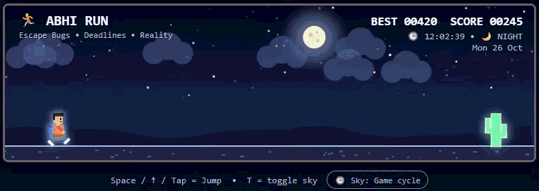

<div align="center">



# 🏃 ABHI RUN

**An endless runner inspired by the Chrome Dino game, reimagined around a programmer's life.**
Abhi runs through day and night, dodging bugs and deadlines.

<a href="https://abhijitpavse.github.io/ABHI-RUN/">
  
</a>


</div>

---

## 📖 About

**ABHI RUN** is built with **HTML5 Canvas, CSS and vanilla JavaScript**, with no libraries and no build step. You play as **Abhi**, a pixel-art programmer who has to survive the daily coding journey by jumping over **bugs** (cactus) and **deadlines** (trees) while chasing a high score.

## ✨ Features

- 🧑‍💻 **Pixel-art human runner** with a running cycle, jump pose and laptop backpack
- 🌗 **Smooth day, dusk, night and dawn cycle** with sun, moon, twinkling stars and sunset glow
- 🌲 **Night-visible obstacles**: bugs and deadlines brighten and glow in the dark
- ⛰️ **Parallax hills**, drifting clouds and a scrolling ground texture
- 🕒 **Live real-time clock and date** shown while you play
- 🌍 **Real-sky mode**: press `T` to make the in-game sky follow your actual local time
- 💾 **High score saved** in your browser (localStorage)
- ⚡ Speed increases as you survive, with a fixed 60 FPS game loop on every screen
- 📱 Keyboard, mouse and touch controls, with a responsive canvas

## 🎮 Controls

| Action | Input |
|:--|:--|
| Jump / Restart | `Space` or `↑` |
| Jump / Restart (mobile) | Tap the screen |
| Toggle sky mode (game cycle ↔ real time) | `T` or the on-screen button |

## 🛠️ Built With


## 📂 Project Structure

```
ABHI-RUN/
├── index.html     # Game: canvas, logic, day/night engine
├── preview.gif    # Gameplay preview used in this README
├── README.md
└── LICENSE        # Apache-2.0
```

## 🚀 Run Locally

```bash
git clone https://github.com/abhijitpavse/ABHI-RUN.git
cd ABHI-RUN
# open index.html in any browser
```

## 🗺️ Roadmap

- [x] Pixel-art Abhi character
- [x] Bug and deadline obstacles
- [x] Save high score
- [x] Day, dusk, night and dawn cycle
- [ ] ☕ Coffee power-ups
- [ ] 💻 Laptop collectibles
- [ ] 🔊 Sound effects and background music
- [ ] 🏆 Achievement system
- [ ] 🌍 Global leaderboard

## 🤝 Contributing

Contributions are welcome. Fork the repo, create a feature branch, commit your changes and open a Pull Request.

## 👨‍💻 Author

**Abhijit Pavse**: [GitHub](https://github.com/abhijitpavse) • [LinkedIn](https://linkedin.com/in/abhijitpavse)

<div align="center">

⭐ If you enjoyed the game, star the repo and share it with your friends!

*If you're reading this... Abhi survived another deadline. 😎*

</div>
